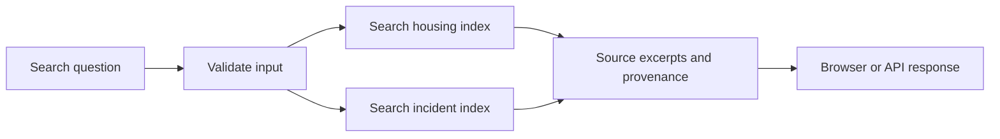
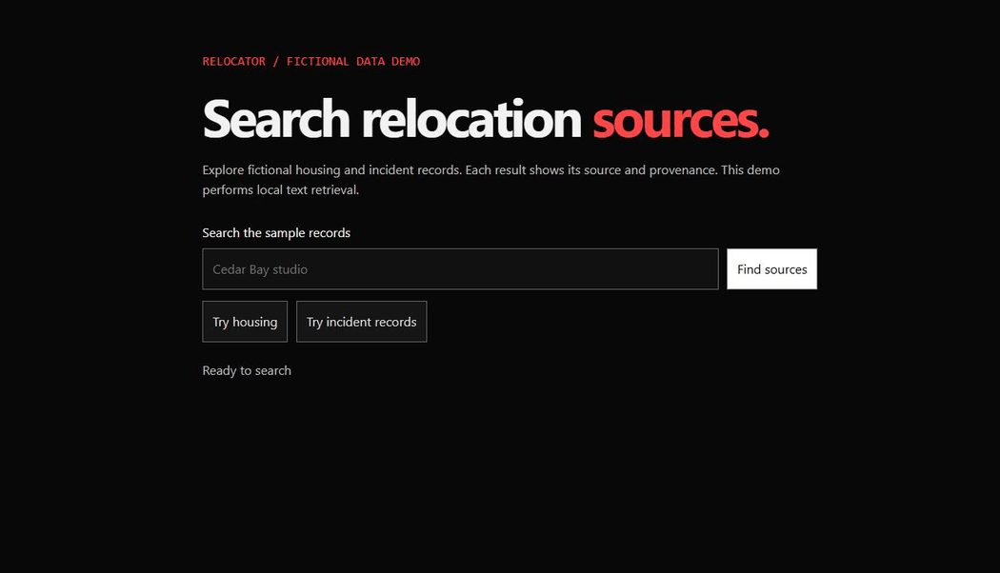

# Relocator · local source explorer

Relocation questions can span housing and incident records with different sources. This hackathon prototype makes each retrieved row traceable by keeping the corpora separate and showing the record ID and provenance.

## Try the demo

Use Python 3.11 or 3.12. From a fresh checkout, create and activate a virtual environment, then run:

```bash
python -m pip install -r requirements-local.txt
python backend.py --demo
```

Open http://127.0.0.1:5004/demo and select **Try housing** or **Try incident records**. The bundled records are fictional and illustrate the retrieval interface. The demo runs locally without credentials.



## Evidence

The browser returned labeled housing and incident excerpts from the bundled fixtures. Nine backend tests and three React tests passed, and the React production build succeeded. These checks establish functionality on fixtures. The archived notebook and original hackathon outcomes are described separately in [historical notes](HISTORICAL_NOTES.md).

## Use your own authorized records

Set `APP_DOMAIN=relocation`, `HOUSING_CSV` to a CSV with `City` and `State` columns, and `PORT=5004`, then run `python backend.py`. An optional `CRIME_CSV` can supply `State`, `County`, `Motivation Type`, and `Incident Count`. Use environment variables appropriate to your shell. See [.env.example](.env.example) for the names.

CSV provenance is declared metadata and defaults to `unverified_supplied_csv`. Results show record excerpts, not city safety estimates or housing recommendations. The bundled demo runs independently of these settings. For a custom corpus, `OLLAMA_MODEL` can optionally point to a local model you already have. Its summaries carry an unverified label and fall back to retrieval when generation fails. Actual model inference was outside this verification.

For the optional React interface, run `npm ci` and `npm start` from `React/` while the backend is running. Use `python -m unittest test_backend -v` for backend checks.

**Tools** · Python, Flask, scikit-learn, TF-IDF, React. Fork and notebook attribution are preserved in the repository history and [repair notes](REPAIR_STATUS.md).

## See it work


